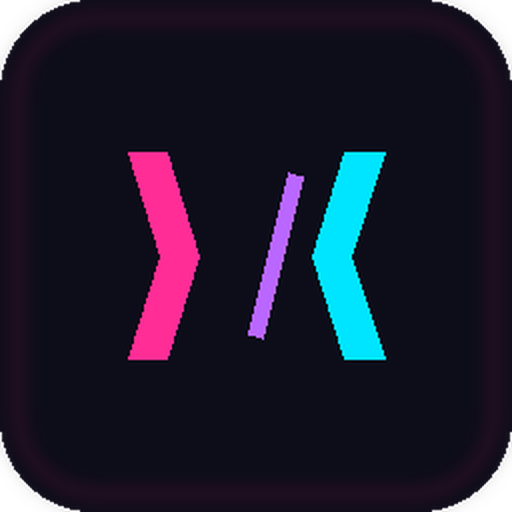

<div align="center">



# nxRift

**Der Browser von nxService & Streams.**
Opera-GX-Feeling im nx-Neon-Look – gebaut für Gamer, Streamer und alle, die ihren Browser selbst formen wollen.

[](https://github.com/neroxservice/nxrift/releases/latest)
[](https://github.com/neroxservice/nxrift/releases)


[**⬇ Download**](https://github.com/neroxservice/nxrift/releases/latest) · [Features](#-features) · [Tastenkürzel](#-tastenkürzel) · [Erweiterungen](#-erweiterungen) · [Entwicklung](#-entwicklung)

</div>

---

> **Status: Beta (0.1.x).** nxRift ist ein junges Projekt. Es läuft stabil im Alltag, aber nicht alles ist fertig – siehe [Bekannte Einschränkungen](#-bekannte-einschränkungen).

<!-- Screenshots einfügen: Bilder nach docs/screenshots/ legen und den Block unten einkommentieren
<div align="center">
  
  
  
  
</div>
-->

## ⬇ Installation

1. Lade den aktuellen Installer **`nxRift-Setup-<Version>.exe`** von der [Releases-Seite](https://github.com/neroxservice/nxrift/releases/latest).
2. Starte die Datei und wähle den Installationsordner.
3. Fertig – nxRift aktualisiert sich ab dann selbst.

> **Windows-Warnung „Der Computer wurde durch Windows geschützt"?**
> Der Installer ist (noch) nicht signiert. Klicke auf **Weitere Informationen → Trotzdem ausführen**.

## ✨ Features

### Oberfläche & Tabs
- **Tab-Gruppen** mit Farbe und Namen – per Rechtsklick auf einen Tab anlegen, ein-/ausklappen, umbenennen
- **Sitzung wiederherstellen** – deine Tabs sind nach dem Neustart wieder da
- **Favoritenleiste** mit Favicons und eigenem Rechtsklick-Menü (umbenennen, verschieben, lösen, löschen)
- **Startseite mit Schnellzugriff-Kacheln** und eigenem **Hintergrundbild** (Fokuspunkt, Zoom, Abdunkeln)
- **Seitenfenster:** Discord, Twitch, YouTube, Spotify und GitHub neben dem aktuellen Tab öffnen
- **Themes:** zehn Farbschemata oder eigene Akzentfarben, Neon-Scrollbars
- Interne Seiten unter `nxrift://settings`, `nxrift://downloads`, `nxrift://history` …

### Rift Control
Dein Kontrollzentrum im GX-Stil (Blitz-Symbol in der Seitenleiste):
- **RAM-Limiter** – schläfert die speicherhungrigsten inaktiven Tabs ein, sobald dein Limit erreicht ist
- **Netzwerkbegrenzer** – getrennte Limits für Download und Upload
- **Gaming-Modus** – niedrigere CPU-Priorität, Tabs schlafen früher ein, RAM-Limiter an
- **Hot Tabs Killer** – Tabs nach CPU oder RAM sortiert, mit Schließen-Knopf
- **Werbeblocker** mit Zähler und **Tab-Sleep**

### Privatsphäre & Sicherheit
- **Werbe- und Tracker-Blocker** auf Basis der Ghostery-Engine mit uBlock-kompatiblen Filterlisten
- **Passwort-Manager** mit Autofill und Speicher-Hinweis, optional mit **Master-Passwort** (AES-256-GCM, Schlüssel per scrypt)
- **Passwort-Generator** (Länge, Zeichenarten)
- Passwörter ohne Master-Passwort sind per **Windows-DPAPI** geschützt

### Komfort
- **Import** aus Opera GX, Opera, Chrome, Chrome Beta, Chromium, Edge, Brave, Vivaldi, Yandex – Favoriten, Passwörter und Tabs; Firefox nur Favoriten
- **Verlauf** und **Downloads** mit Fortschritts-Animation in der Adressleiste, eigenem Download-Ordner und „Speichern unter…"
- **Rechtsklick-Menü** wie im Browser deiner Wahl: Bild speichern/kopieren/suchen, Link öffnen, Text suchen, Element untersuchen
- **Screenshot** des aktuellen Tabs (`Strg+Shift+S`)
- Standard-Suchmaschine wählbar (Google, DuckDuckGo, Bing, Brave, Ecosia, Startpage)
- **Auto-Update** über GitHub Releases

## ⌨ Tastenkürzel

| Taste | Aktion |
|---|---|
| `Strg+T` / `Strg+Shift+T` | Neuer Tab / geschlossenen Tab wiederherstellen |
| `Strg+W` | Tab schließen (auch **Mittelklick** auf den Tab) |
| `Strg+Tab` / `Strg+Shift+Tab` | Nächster / vorheriger Tab |
| `Strg+1` … `Strg+9` | Zu Tab 1–8 bzw. letzter Tab |
| `Strg+L` / `Alt+D` | Adressleiste fokussieren |
| `F5` / `Strg+R` | Neu laden |
| `Alt+←` / `Alt+→` | Zurück / Vor (auch Maus-Zusatztasten) |
| `Strg+D` | Favorit hinzufügen oder entfernen |
| `Strg+,` | Einstellungen |
| `Strg+H` / `Strg+J` | Verlauf / Downloads |
| `Strg+Shift+S` | Screenshot |
| `F12` | Entwicklertools |

## 🧩 Erweiterungen

nxRift kann **Chrome-Erweiterungen** aus dem Chrome Web Store installieren (*Einstellungen → Erweiterungen*). Die Symbole erscheinen rechts in der Adressleiste.

**Läuft meist:** Darstellungs-Erweiterungen (z. B. Dark Mode), Tools mit Popup, Seiten-Skripte.
**Eingeschränkt:** Passwort-Manager (kein Native Messaging) und Werbeblocker, die klassische Netzwerk-Filter-APIs brauchen. Dafür ist der eingebaute Werbeblocker da.
**Nicht möglich:** Chrome-Konto/Sync. Opera-Erweiterungen lassen sich nur als entpackter Ordner laden.

Erweiterungen laufen mit den Rechten, die sie anfordern – nxRift zeigt sie dir vor der Installation an. Installiere nur, was du kennst.

## ⚠ Bekannte Einschränkungen

- **Nur Windows** (10/11). macOS und Linux sind nicht geplant.
- **Kein DRM (Widevine):** Streaming-Dienste mit Kopierschutz wie Netflix oder Disney+ funktionieren nicht.
- **Google-Login** kann in Electron-basierten Browsern blockiert werden.
- Kein Konto-**Sync** zwischen Geräten.
- Der Installer ist **nicht signiert** (SmartScreen-Hinweis).
- Firefox-Import: nur Favoriten (Passwörter und Tabs haben dort ein anderes Format).
- Basis ist **Electron** und kein eigener Chromium-Fork – Sicherheits-Updates kommen mit neuen nxRift-Versionen.

## 🔒 Datenschutz

- Deine Daten (Favoriten, Verlauf, Passwörter, Einstellungen) liegen **lokal** unter `%APPDATA%\nxRift`. nxRift hat kein Konto und schickt keine Telemetrie.
- **Favicons** holt nxRift von der Seite selbst und – falls dort keins liegt – über DuckDuckGo bzw. Google. Dabei erfährt der Dienst den Domainnamen.
- **Updates** werden über GitHub Releases geprüft, **Erweiterungen** über den Chrome Web Store.
- Die Filterlisten des Werbeblockers werden beim Start heruntergeladen und aktualisiert.

## 🛠 Entwicklung

Voraussetzungen: **Node.js 20+**, Windows.

```bash
git clone https://github.com/neroxservice/nxrift.git
cd nxrift
npm install
npm start          # Entwicklung
npm run dist       # Installer bauen (dist/nxRift-Setup-<Version>.exe)
npm run release    # bauen + als GitHub Release veröffentlichen (GH_TOKEN nötig)
```

**Veröffentlichen:** Version in `package.json` hochzählen, `GH_TOKEN` setzen (`$env:GH_TOKEN="…"` in PowerShell), dann `npm run release`. Für den Auto-Update-Test brauchst du zwei Versionen.

**Projektstruktur**

```
main.js          Hauptprozess: Tabs, Rift Control, Downloads, Tresor, Erweiterungen, Updates
preload.js       Brücke zur Oberfläche (enthält die Erweiterungs-Leiste)
tabpreload.js    Passwort-Autofill und interne Seiten-Schnittstelle
import.js        Import aus anderen Browsern
ui/              Oberfläche, Einstellungen, Startseite
build/           Icons und Installer-Grafiken
tools/           Hilfsskripte
```

**Fehlersuche**
- Protokoll: `%APPDATA%\nxRift\crash.log`
- **Sicherer Start:** Startet nxRift nach einem Absturz nicht sauber, versucht es beim nächsten Mal ohne Erweiterungen (Stufe 1), danach zusätzlich ohne Tab-Wiederherstellung (Stufe 2).
- Umgebungsvariablen: `NXRIFT_PROFILE=dev` (eigenes Profil für die Entwicklung), `NXRIFT_LEVEL=0|1|2` (Stufe erzwingen), `NXRIFT_TRACE=0` (Ablaufspur im Protokoll abschalten)

## 🙏 Credits

[Electron](https://www.electronjs.org/) · [Ghostery Adblocker](https://github.com/ghostery/adblocker) · [electron-chrome-extensions](https://github.com/samuelmaddock/electron-browser-shell) & electron-chrome-web-store · [electron-updater / electron-builder](https://www.electron.build/) · [sql.js](https://github.com/sql-js/sql.js) · [Simple Icons](https://simpleicons.org/)

Die Marken-Symbole in der Seitenleiste (Discord, Twitch, YouTube, Spotify, GitHub) gehören ihren jeweiligen Inhabern. nxRift steht in keiner Verbindung zu Opera, Google oder den genannten Diensten; „Opera GX" und „Chrome" dienen nur als Inspiration bzw. Beschreibung der Kompatibilität.

## 📄 Lizenz

*Noch festzulegen* – bevor du das Repo öffentlich machst, füge eine `LICENSE`-Datei hinzu und trage sie hier ein.

---

<div align="center">

Gebaut von **NeroX** · **nxService & Streams**

</div>
